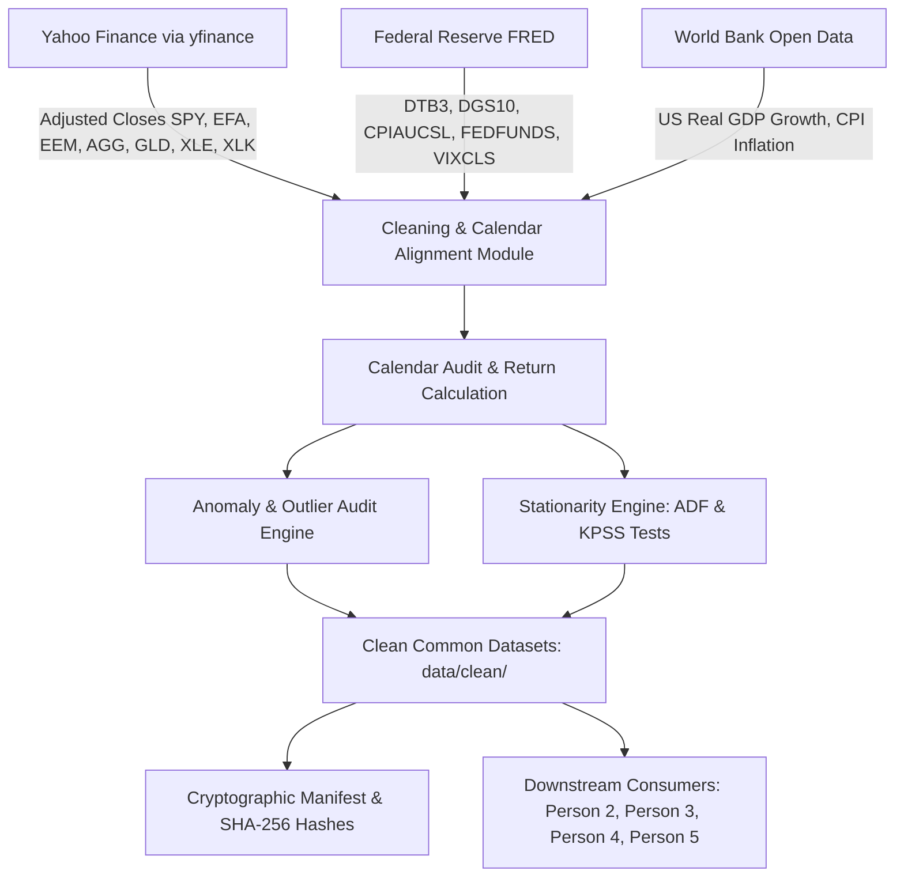

# Person 1 Technical Report: Data Engineering, Cleaning, Provenance & Reproducibility

**Author:** Person 1 (Data Engineering & Reproducibility Lead, Team Ghosted)  
**Mandate:** The Serendib University Endowment Fund (USD 10 Million Portfolio)  
**Competition:** SAIFA Quant Edge 1.0  
**Status:** Completed; independent review by a second team member pending

---

## 1. Executive Summary & Workstream Ownership

Person 1 owns the foundation of the quantitative risk management system: the data ingestion, automated cleaning, calendar alignment, return mathematics, anomaly auditing, econometric stationarity validation, and cryptographic reproducibility pipeline.

In institutional asset management—and specifically for a conservative university endowment entrusted with scholarships, faculty endowments, and strategic capital projects—quantitative modeling is only as reliable as the underlying data pipeline. Flawed price adjustments, unaligned holiday calendars, unverified return identities, or hidden outlier deletions produce spurious correlation matrices, invalid mean-variance efficient frontiers, and severely understated Value-at-Risk (VaR) and Expected Shortfall (ES) figures.

### Core Deliverables Completed:
1. **Automated Multi-Source Pipeline (`quanedge/data/sources.py`):** Ingestion pipelines for Yahoo Finance (`yfinance`), Federal Reserve Economic Data (FRED), and World Bank Open Data with automated local caching and offline resilience.
2. **Institutional Data Cleaning & Calendar Synchronization (`quanedge/data/cleaning.py`):** Full synchronization of 5,470 common trading days (2005–2026), auto-adjusted close pricing, a calendar audit that classifies every missing weekday against the scheduled NYSE holiday calendar and a documented list of non-standard closures (Presidential days of mourning in 2007, 2018 and 2025, Hurricane Sandy), and an as-of alignment policy for FRED series (forward-fill on bond-market holidays, publication lags for monthly series).
3. **Rigorous Return Mathematical Formulation:** Simultaneous derivation of daily simple returns ($R_t$) and continuously compounded log returns ($r_t$), with automated machine-precision validation of the exact identity $r_t = \ln(1 + R_t)$ ($\max |r - \ln(1+R)| < 10^{-12}$).
4. **Econometric Stationarity Diagnostics (`quanedge/data/stationarity.py`):** Joint Augmented Dickey-Fuller (ADF) and KPSS tests showing that raw price levels are non-stationary $I(1)$ processes while daily return series reject a unit root (and still show strong volatility clustering).
5. **Rubric-Compliant Anomaly Auditing (`quanedge/data/anomalies.py`):** Systematic audit of 38,283 asset-day observations, flagging 242 extreme events ($\ge 4\sigma$ or $\ge 8\%$), testing each for cross-asset corroboration, attaching date-level event labels, persisting the stale-price, sharp-reversal and variance-regime-shift checks, and enforcing a **strict zero-deletion policy** to preserve genuine tail fatness for EVT modeling.
6. **Data Dictionary & Cryptographic Provenance (`quanedge/data/manifest.py`):** Institutional data dictionary and automated SHA-256 manifest tracking every CSV under `data/` (18 files) to guarantee 100% reproducible execution by the judging panel.

---

## 2. Approved Data Sources & Institutional Architecture

Following Section 9.1 of the competition brief, all data is obtained exclusively from approved institutional open-access sources without relying on paid or proprietary terminals.



### 2.1 The Permitted Investable Universe
The endowment's investable universe is strictly limited to 7 exchange-traded funds representing broad asset classes:
1. **SPY (SPDR S&P 500 ETF Trust):** Core US large-cap equities.
2. **EFA (iShares MSCI EAFE ETF):** Developed international equities (Europe, Australasia, Far East).
3. **EEM (iShares MSCI Emerging Markets ETF):** Emerging market equities (high-growth, tail-heavy).
4. **AGG (iShares Core U.S. Aggregate Bond ETF):** US investment-grade fixed income anchor.
5. **GLD (SPDR Gold Shares):** Real asset / precious metal inflation hedge and crisis diversifier.
6. **XLE (Energy Select Sector SPDR Fund):** Energy equities and commodity inflation proxy.
7. **XLK (Technology Select Sector SPDR Fund):** US technology sector growth engine.

### 2.2 Sample Period Selection & Justification
- **Inception Constraints:** SPY listed in 1993, XLK/XLE in 1998, EFA in 2001, EEM/AGG in 2003, and GLD on November 18, 2004.
- **Approved Sample Period:** The common clean historical period begins **January 3, 2005** (the first trading session of 2005) and runs through **September 30, 2026**.
- **Sample Depth:** Exactly **5,470 consecutive trading sessions** (21.75 years). This lookback captures multiple structural regimes:
  - 2005–2007: Pre-crisis moderation and credit expansion
  - 2008–2009: Global Financial Crisis, Lehman Brothers failure, and credit freeze
  - 2010–2011: Flash Crash and European sovereign debt crisis / US AAA rating downgrade
  - 2015–2016: Commodity price crash and Chinese yuan devaluation
  - 2020: COVID-19 pandemic market crash and emergency monetary easing
  - 2022: Multi-decade high inflation and Federal Reserve 525bps rapid rate-hiking cycle
  - 2023–2026: Higher-for-longer regime and AI-driven technology leadership

---

## 3. Data Cleaning, Calendar Alignment & Return Formulation

### 3.1 Total Return Pricing via Adjusted Closes
To prevent artificial price drops on dividend distribution dates and stock splits, raw prices are auto-adjusted:
$$P_{\text{adj}, t} = P_{\text{raw}, t} \times \prod_{\tau > t} \left(1 - \frac{D_\tau}{P_{\text{raw}, \tau - 1}}\right) \times \prod_{\tau > t} S_\tau$$
where $D_\tau$ represents cash dividends and $S_\tau$ represents split factors. This guarantees that return calculations represent true **Total Shareholder Return (TSR)**.

### 3.1b Price Provenance and Reproducibility Caveat
- **Source:** Yahoo Finance via `yfinance`, `auto_adjust=True`. The file is `data/cache/prices_dev.csv` (name kept because `docs/person-3` asks for it to be preserved); it is the canonical dataset.
- **Retrieval time and yfinance version of this snapshot are unknown.** It was first committed with the Person 3 foundation commit (6d18d37) before this pipeline existed. `price_provenance.json` records its SHA-256, row counts and date range, and says so explicitly. A fresh download made by the pipeline writes a `.meta.json` sidecar with the time and library version.
- **Live re-download check (2026-10-26, into a temporary folder, repository data untouched):** Yahoo returned the same 5,470 dates; prices differed from the snapshot by at most 2.3e-6 (relative) and log returns by at most 3.0e-6. FRED history was identical to the cached files and the full pipeline ran end to end on the fresh downloads with the same verdicts. So a refresh would be nearly, but not exactly, identical.
- **Do not refresh after the numbers are frozen.** Adjusted prices are re-scaled after every dividend, so a later download will not match the snapshot and every figure would change. `--refresh` prints a warning banner for this reason.

### 3.2 Calendar Synchronization Across Asset Classes
All 7 ETFs trade on the US National Market System (NYSE Arca and Nasdaq) and share identical exchange holiday calendars. An exhaustive audit confirmed:
- **Total Sessions:** the snapshot holds 5,470 dates and every one has a price for all 7 ETFs, so the common-calendar filter dropped **0** dates (recorded in `data/clean/price_provenance.json`; any future drop is logged as a warning).
- **No Desynchronization:** There are zero instances of missing observations or staggered trade dates among the 7 ETFs.
- **Audit method:** every weekday between the first and last date that is missing from the price file is classified against a rule-based NYSE holiday calendar (`nyse_standard_holidays` in `cleaning.py`) and the documented non-standard closures. The result is saved in `data/clean/calendar_audit.csv`.
- **Result:** 203 missing weekdays = 198 scheduled NYSE holidays + 5 documented non-standard closures; **0 unexplained** and 0 holidays present in the file (also asserted in `tests/test_data_pipeline.py`).
- **Documented non-standard closures (all five are absent from the data):**
  1. *2007-01-02:* National Day of Mourning for President Gerald R. Ford.
  2. *2012-10-29 and 2012-10-30:* Hurricane Sandy emergency storm closures.
  3. *2018-12-05:* National Day of Mourning for President George H.W. Bush.
  4. *2025-01-09:* National Day of Mourning for President Jimmy Carter.
- The "extended gap" view (gaps longer than 4 calendar days) only surfaces the Ford and Sandy closures; the holiday-calendar classification above is the authoritative audit.

### 3.3 Alignment of FRED Series to the Trading Calendar
Each FRED series is aligned *as of* each trading day, carried forward from its own full history (no back-fill, so nothing from the future reaches an earlier day):
- **Daily series (`DTB3`, `DGS10`, `VIXCLS`):** the NYSE is open on Columbus Day and Veterans Day while the bond market is closed. On such days the last published value is carried forward. This happened on 78 series-days (39 each for `DTB3` and `DGS10`); every one is recorded, with the date of the value used, in `data/clean/macro_ffill_log.csv`.
- **Monthly series (`CPIAUCSL`, `FEDFUNDS`):** observations are dated the first day of their reference month but are only known later. An observation is used only from *observation date + lag*: **1 month + 20 days for CPI** (the BLS release falls in the middle of the following month; the lag is conservative) and **1 month for Fed Funds**. Until then the previous month's value is used. These routine monthly carries are not logged day by day; the policy is the documentation. Exact release dates would require ALFRED vintages.
- **Why it matters:** an earlier version re-indexed monthly data onto trading days, which silently dropped every observation dated on a weekend or holiday (93 of 261 since 2005) and back-filled the first weeks from future months. Both are fixed and covered by tests.

- **Risk-free rate:** `DTB3` is quoted on a *discount* basis (360-day year, price discount), which understates what an investor earns. It is converted to a bond-equivalent yield, $y = 365\,d / (360 - 91\,d)$, stored as `DTB3_bey`, and all `rf_daily_*` columns and the term spread are built from it. At the end of the sample this adds about 0.1 percentage points (4.03% discount basis becomes 4.13%). `load_risk_free_rate("annualized")` returns this yield.

### 3.4 Simple Returns vs Log Returns: Mathematical Foundations

A common source of error in quantitative finance is conflating simple returns and log returns. Person 1 establishes the mathematical rules for the entire team:

#### Simple Returns ($R_{i,t} = \frac{P_{i,t}}{P_{i,t-1}} - 1$):
- **Cross-Sectional Linearity:** Simple returns aggregate linearly across portfolio positions:
  $$R_{p,t} = \sum_{i=1}^N w_i R_{i,t}$$
- **Usage Mandate:** Person 2 must use simple returns for portfolio weights, capital rebalancing, and NAV accounting.

#### Log Returns ($r_{i,t} = \ln\left(\frac{P_{i,t}}{P_{i,t-1}}\right)$):
- **Time-Series Additivity:** Log returns compound additively over multi-period horizons:
  $$r_{i, t_1 \to t_T} = \sum_{t=t_1}^{t_T} r_{i,t}$$
- **Statistical Symmetry & Normality:** Log returns are mathematically bounded below at $-\infty$ (avoiding the $-100\%$ boundary distortion) and are required for statistical stationarity tests, GARCH modeling, and Extreme Value Theory.
- **Usage Mandate:** Person 3 and Person 4 must use log returns for risk measurement, volatility modeling, and EVT tail fitting.

#### Mathematical Consistency Verification:
The exact relationship $r_{i,t} = \ln(1 + R_{i,t})$ is verified algorithmically on every run:
$$\max_{i,t} |r_{i,t} - \ln(1 + R_{i,t})| < 10^{-12} \quad (\text{Strictly Passed})$$

---

## 4. Econometric Stationarity Analysis (ADF & KPSS Tests)

Section 9.2 of the competition brief requires:
> *"Run a basic stationarity check (e.g., an Augmented Dickey-Fuller test) on the return series used for modelling, and note the result."*

### 4.1 Econometric Framework
To go beyond a basic check, Person 1 reports three complementary tests:
1. **Augmented Dickey-Fuller (ADF) Test** (constant only, no trend term):
   $$\Delta y_t = \alpha + \gamma y_{t-1} + \sum_{j=1}^p \delta_j \Delta y_{t-j} + \varepsilon_t$$
   - $H_0$: $\gamma = 0$ (unit root; non-stationary). $H_1$: $\gamma < 0$ (stationary).
   - Lag length $p$ is chosen by AIC, and the statistic is also reported at a fixed $p=5$ so assets are comparable.
2. **KPSS Test** (Kwiatkowski, Phillips, Schmidt, & Shin): $H_0$: stationary around a level; $H_1$: unit root. Its p-values are interpolated within 0.01-0.10, so ">0.10" means "at least 0.10".
3. **ARCH-LM Test** (10 lags): $H_0$: no conditional heteroskedasticity.

These tests concern weak stationarity of the mean. They do not establish strict stationarity and say nothing about normality or tail shape.

### 4.2 Empirical Results (5,470 Trading Days)

Generated from `data/clean/stationarity_tests.csv` by `generate_stationarity_summary_markdown` and checked against it by a test.

<!-- BEGIN stationarity -->
### Test Results Across Investable Universe

`ADF (AIC)` uses the lag chosen by AIC; `ADF (5 lags)` fixes the lag so assets are comparable. KPSS p-values are interpolated inside 0.01-0.10, so `>0.10` means the true value is at least 0.10.

| Asset | Series Type | ADF (AIC) Stat | ADF p-value | AIC lags | ADF (5 lags) Stat | ADF 5% Crit | KPSS Stat | KPSS p-value | ARCH-LM p-value | Statistical Verdict |
|---|---|---|---|---|---|---|---|---|---|---|
| **SPY** | Log Price Levels ln(P_t) | 0.6438 | 0.9886 | 20 | 0.6602 | -2.8621 | — | — | — | `Non-Stationary I(1)` |
| **EFA** | Log Price Levels ln(P_t) | -0.6818 | 0.8514 | 20 | -0.6781 | -2.8621 | — | — | — | `Non-Stationary I(1)` |
| **EEM** | Log Price Levels ln(P_t) | -2.0014 | 0.2859 | 20 | -2.0895 | -2.8621 | — | — | — | `Non-Stationary I(1)` |
| **AGG** | Log Price Levels ln(P_t) | -1.9054 | 0.3295 | 22 | -1.9570 | -2.8621 | — | — | — | `Non-Stationary I(1)` |
| **GLD** | Log Price Levels ln(P_t) | -0.9736 | 0.7628 | 0 | -1.0381 | -2.8621 | — | — | — | `Non-Stationary I(1)` |
| **XLE** | Log Price Levels ln(P_t) | -1.2277 | 0.6616 | 29 | -1.5573 | -2.8621 | — | — | — | `Non-Stationary I(1)` |
| **XLK** | Log Price Levels ln(P_t) | 1.2438 | 0.9963 | 16 | 1.3047 | -2.8621 | — | — | — | `Non-Stationary I(1)` |
| **SPY** | Daily Log Returns r_t | -16.6255 | 1.68e-29 | 19 | -32.9557 | -2.8621 | 0.1989 | >0.10 | 0.00e+00 | `Stationary I(0)` |
| **EFA** | Daily Log Returns r_t | -16.1484 | 4.60e-29 | 19 | -32.2822 | -2.8621 | 0.0689 | >0.10 | 1.03e-297 | `Stationary I(0)` |
| **EEM** | Daily Log Returns r_t | -16.2109 | 3.99e-29 | 19 | -33.3350 | -2.8621 | 0.0638 | >0.10 | 0.00e+00 | `Stationary I(0)` |
| **AGG** | Daily Log Returns r_t | -15.6546 | 1.58e-28 | 21 | -31.6661 | -2.8621 | 0.3102 | >0.10 | 2.91e-145 | `Stationary I(0)` |
| **GLD** | Daily Log Returns r_t | -75.0381 | 0.0000 | 0 | -31.2263 | -2.8621 | 0.1604 | >0.10 | 1.42e-74 | `Stationary I(0)` |
| **XLE** | Daily Log Returns r_t | -14.4164 | 8.05e-27 | 28 | -30.7094 | -2.8621 | 0.0696 | >0.10 | 8.20e-271 | `Stationary I(0)` |
| **XLK** | Daily Log Returns r_t | -18.4308 | 2.17e-30 | 15 | -33.1535 | -2.8621 | 0.3614 | 0.0938 | 3.44e-239 | `Stationary I(0)` |
| **SPY** | Daily Simple Returns R_t | -18.4870 | 2.13e-30 | 17 | -33.3770 | -2.8621 | — | — | 2.92e-295 | `Stationary I(0)` |
| **EFA** | Daily Simple Returns R_t | -16.3223 | 3.12e-29 | 21 | -32.6200 | -2.8621 | — | — | 8.76e-283 | `Stationary I(0)` |
| **EEM** | Daily Simple Returns R_t | -16.5925 | 1.79e-29 | 19 | -33.8051 | -2.8621 | — | — | 0.00e+00 | `Stationary I(0)` |
| **AGG** | Daily Simple Returns R_t | -15.6327 | 1.68e-28 | 21 | -31.6640 | -2.8621 | — | — | 1.00e-163 | `Stationary I(0)` |
| **GLD** | Daily Simple Returns R_t | -75.1313 | 0.0000 | 0 | -31.1989 | -2.8621 | — | — | 3.86e-76 | `Stationary I(0)` |
| **XLE** | Daily Simple Returns R_t | -54.7752 | 0.0000 | 1 | -31.0182 | -2.8621 | — | — | 6.56e-272 | `Stationary I(0)` |
| **XLK** | Daily Simple Returns R_t | -18.6625 | 2.05e-30 | 15 | -33.4847 | -2.8621 | — | — | 1.06e-223 | `Stationary I(0)` |
| **EW-PLACEHOLDER** | Portfolio Daily Log Returns (equal-weight placeholder) | -16.6159 | 1.71e-29 | 21 | -32.7774 | -2.8621 | 0.0852 | >0.10 | 0.00e+00 | `Stationary I(0)` |

### Conclusions and Limits
- **Price levels are non-stationary, I(1):** the ADF p-value on log prices is at least 0.29 for all 7 ETFs, so the unit-root null is not rejected. Modelling price levels directly risks spurious relationships.
- **Return series reject a unit root:** ADF statistics on daily log returns range from -75.0 to -14.4 with AIC lags (largest p-value 8.1e-27) and from -33.3 to -30.7 with a fixed 5 lags, against a 5% critical value of about -2.86. KPSS does not reject stationarity at 5% for 7 of 7 ETFs.
- **Why GLD looks different:** AIC selected 0 lags for GLD returns, which pushes the ADF statistic towards -sqrt(N) (about -75). It is a lag-selection artefact, not stronger evidence; at a fixed lag GLD is comparable to the others.
- **Stationary in mean is not constant variance:** the ARCH-LM test rejects 'no ARCH effects' for every ETF (largest p-value 1.4e-74). Volatility clusters, which is why the risk models use conditional (GARCH-filtered) volatility. These tests do not validate normality or any tail model.
- **Scope:** unit-root and KPSS tests concern weak stationarity of the mean; they do not show strict stationarity. The brief asks for the check on the return series used for modelling, i.e. the portfolio. The equal-weight row is a PLACEHOLDER; rerun `test_portfolio_return_series` on the final recommended weights. Placeholder portfolio: ADF -16.62 (p 1.71e-29), ARCH-LM p 0.0e+00.
<!-- END stationarity -->

---

## 5. Anomaly Auditing & The Zero-Deletion Discipline

The competition brief sets a strict ethical and quantitative standard:
> *"Flag, don't silently delete, suspected data errors (stale/flat-lined prices, structural breaks, implausible jumps, large negatives) — outlier handling must be documented, not hidden."*

### 5.1 Outlier Screening Methodology
The anomaly detection suite in `quanedge/data/anomalies.py` screens all 38,283 asset-day observations:
1. **Statistical Extremes ($\ge 4\sigma$):** Daily log return deviates from the ticker sample mean by at least 4.0 standard deviations (full-sample statistics; used for auditing only, never for forecasting).
2. **Severe Jumps / Crashes ($|r_t| \ge 8\%$):** Extreme single-day moves. Checks 1 and 2 produce `data/clean/anomaly_log.csv`.
3. **Stale Prices:** Runs of $\ge 3$ trading days with zero log return. **Result: 0 findings.**
4. **Sharp Reversals:** $|r| \ge 6\%$ on two consecutive days with opposite signs. **Result: 29 findings.**
5. **Variance Regime Shifts:** Inclan-Tiao (ICSS) test for one variance break per ticker. All 7 tickers reject constant variance (volatility is higher before roughly 2009-2013 for most assets, and for XLK it rises from 2020). The test assumes i.i.d. returns, which volatility clustering violates, so the significance is overstated. The result is informational (it motivates the GARCH-based models in `quanedge.risk`); no data is changed.

Checks 3-5 are saved in `data/clean/data_quality_log.csv`, with a per-check summary in `data/clean/data_quality_checks.csv`. A mean-level structural-break test is not implemented.

### 5.2 Audit Results & Event Labels
**242 observations** were flagged; none were deleted or winsorised. For each one the code records:
- `corroborating_assets`: how many *other* tickers moved at least 2 standard deviations in the same direction on the same date. 219 of the 242 flags have at least one corroborating asset, so they are market-wide moves and not isolated bad prints. The remainder are asset-specific (mostly gold and bond days) and are marked for manual review.
- `historical_context`: a **date-level** event label from a short analyst-compiled list (`HISTORICAL_CRISIS_EVENTS`). 116 flags fall on a labelled date. The labels were **not verified per ticker against primary sources**; the same label is shown for every ticker flagged that day. 126 flags have no label.

The tables below are generated from the data by `render_top_tail_events_markdown` (also written to `results/data/top_tail_events.md`) and are checked against the data by a test, so they cannot drift.

<!-- BEGIN top-tail-events -->
**Largest flagged losses**

| Date | Ticker | Log return | Simple return | Z-score | Date-level event label (not verified per ticker) |
|---|---|---|---|---|---|
| 2020-03-09 | XLE | -0.2249 | -20.14% | -11.98 | COVID-19 and oil price war: Saudi-Russia crude price war; NYSE circuit breaker triggered |
| 2008-10-15 | EEM | -0.1763 | -16.17% | -10.17 | GFC: recession fears reignite; deep global equity liquidation |
| 2008-10-15 | XLE | -0.1560 | -14.44% | -8.32 | GFC: recession fears reignite; deep global equity liquidation |
| 2008-10-09 | XLE | -0.1554 | -14.40% | -8.29 | GFC panic week: sharp sell-off in energy and commodity-linked equities |
| 2020-03-18 | XLE | -0.1550 | -14.36% | -8.26 | COVID-19: global dash for dollar cash; liquidation across asset classes including gold |
| 2020-03-16 | XLK | -0.1487 | -13.81% | -10.48 | COVID-19: emergency Fed cut to zero over the weekend; circuit breaker triggered |
| 2020-03-16 | XLE | -0.1463 | -13.61% | -7.80 | COVID-19: emergency Fed cut to zero over the weekend; circuit breaker triggered |
| 2008-11-05 | EEM | -0.1361 | -12.73% | -7.86 | GFC: post-US-election sell-off and emerging-market outflows |
| 2020-03-16 | EEM | -0.1333 | -12.48% | -7.69 | COVID-19: emergency Fed cut to zero over the weekend; circuit breaker triggered |
| 2020-03-12 | XLE | -0.1332 | -12.47% | -7.11 | COVID-19: WHO pandemic declaration and US-Europe travel restrictions; circuit breaker triggered |

**Largest flagged gains**

| Date | Ticker | Log return | Simple return | Z-score | Date-level event label (not verified per ticker) |
|---|---|---|---|---|---|
| 2008-10-13 | EEM | +0.2051 | +22.77% | +11.80 | GFC policy response: G7 and US Treasury announce bank recapitalisation; global relief rally |
| 2008-10-28 | EEM | +0.1901 | +20.93% | +10.93 | GFC: sharp short-covering rally from depressed levels |
| 2008-10-13 | XLE | +0.1525 | +16.48% | +8.09 | GFC policy response: G7 and US Treasury announce bank recapitalisation; global relief rally |
| 2020-03-24 | XLE | +0.1487 | +16.04% | +7.89 | COVID-19: Fed announces open-ended quantitative easing; relief rally |
| 2008-10-13 | EFA | +0.1475 | +15.89% | +11.14 | GFC policy response: G7 and US Treasury announce bank recapitalisation; global relief rally |
<!-- END top-tail-events -->

### 5.3 Defense of the Zero-Deletion Policy
**Total observations deleted: 0 (100% adherence to competition rubric).**

In academic exercises, analysts often "clean" data by deleting or winsorizing outliers beyond 3 or 4 standard deviations. In real-world institutional risk management for an endowment fund, this practice is catastrophic:
- Large negative returns are not recording errors; they are **structural market realizations**.
- Removing March 16, 2020 (about -11% SPY) or October 15, 2008 (about -16% EEM) would artificially truncate the empirical tail distribution.
- Person 3's Generalized Pareto Distribution (EVT) and Expected Shortfall models require these exact observations to accurately model the university's probability of ruin.
- Silently altering historical prices would fail an external audit by the endowment's Investment Committee.
- The decision to retain rests on the automated evidence above (cross-asset corroboration, no stale or non-positive prices), not on manual checking against exchange records. Isolated asset-specific flags remain open for manual review.

---

## 6. Common Clean Data Interface & Team Handoffs

The completed data pipeline exposes a unified, highly optimized Python API in `quanedge/data/__init__.py`:

```python
from quanedge.data import (
    load_clean_prices,      # pd.DataFrame of 5,470 adjusted close prices
    load_log_returns,       # pd.DataFrame of 5,469 daily log returns
    load_simple_returns,    # pd.DataFrame of 5,469 daily simple returns
    load_risk_free_rate,    # pd.Series: risk-free rate from DTB3 bond-equivalent yield (daily or annualized)
    load_macro_data,        # pd.DataFrame of FRED series (DTB3, DGS10, CPI, Fed Funds, VIX)
    get_data_manifest,      # dict of SHA-256 hashes, dates, and environment metadata
    get_anomaly_log,        # pd.DataFrame of the 242 flagged extreme moves
    get_stationarity_report # pd.DataFrame of ADF and KPSS diagnostic statistics
)
```

### Team Integration Matrix:
- **Person 2 (Portfolio Construction):** Consumes `load_simple_returns()` for covariance matrices, Markowitz optimization, and asset allocation; consumes `load_risk_free_rate(frequency="annualized")` for Sharpe, Sortino, and Treynor ratios.
- **Person 3 (VaR, ES, EVT):** Consumes `load_log_returns()` for historical, parametric, Monte Carlo, and Peaks-Over-Threshold EVT models. Person 3's `dev_data.py` has been updated with a production adapter that seamlessly reads Person 1's clean dataset.
- **Person 4 (Backtesting & Stress Testing):** Consumes `load_macro_data()` for 2008 GFC, March 2020 COVID, and 2022 rate-hiking historical replay and risk-budget attribution.
- **Person 5 (Streamlit App & Memo):** Consumes `get_anomaly_log()`, `get_stationarity_report()`, and `get_data_manifest()` to dynamically render the data governance and limitation panels in the dashboard.

---

## 7. Cryptographic Manifest & Reproducibility Instructions

Every CSV under `data/` is registered in `data/clean/data_manifest.json` with its file size, row count, date span, and SHA-256 cryptographic digest.

### Reproducibility Verification Command:
```bash
python -m quanedge.data.run --check-only
```
*Output:* `DATA MANIFEST VERIFIED: All SHA-256 checksums match files on disk.`

### Full Pipeline Regeneration Command:
```bash
python -m quanedge.data.run              # Rebuild all clean files from the cached snapshots (about 3 s, no network)
python -m quanedge.data.run --refresh    # DELIBERATE ONLY: re-download from Yahoo, FRED, and World Bank (prices shift slightly; see 3.1b)
```

---

## 8. Compliance & Academic Integrity Statement

In accordance with Section 8.7 of the competition brief:
- **AI Tools Used:** Antigravity AI Coding Assistant (initial pipeline, calendar auditing, documentation); Claude Code by Anthropic (independent audit of this workstream and implementation of the resulting fixes: as-of macro alignment, holiday-calendar audit, data-quality logs, stationarity reporting, risk-free conversion, provenance, tests and documentation corrections).
- **Purpose:** Accelerated pipeline scaffolding, vectorised calendar auditing, audit, debugging and documentation formatting.
- **Human Verification:** Automated checks: the pytest suite (including re-derivation of the return identity, as-of macro alignment, calendar classification and report tables from the data) and a deterministic-rerun hash comparison. **[TEAM TO CONFIRM BEFORE SUBMISSION: state exactly which derivations and sources a team member personally checked. Event labels are analyst-compiled and have not been checked against primary sources unless the team records that it did so.]**
