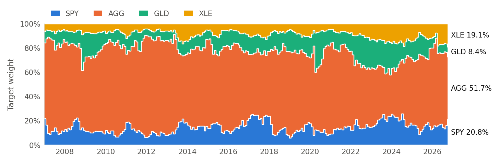
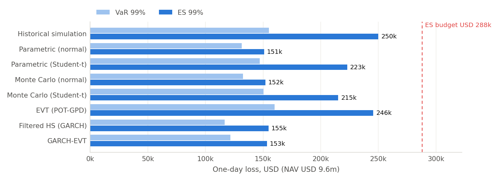
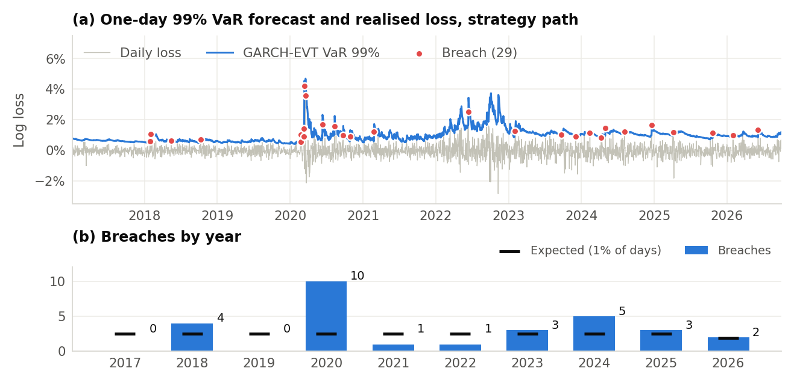
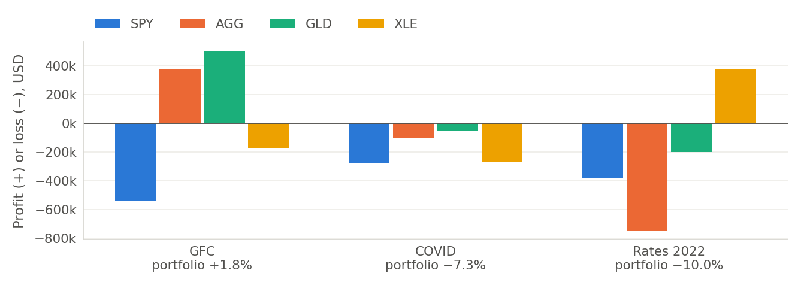
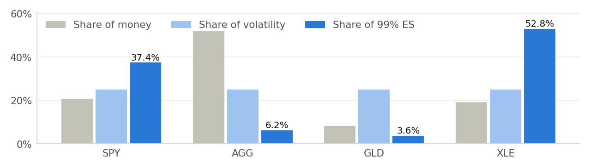

# Monthly dynamic risk parity with a recession overlay for the Serendib University Endowment Fund

Technical report and investment memorandum · Team Ghosted (solo entry) · Quant Edge 1.0 final  
Data 3 Jan 2005 to 30 Sep 2026 · prepared 31 Oct 2026 · committee dashboard: python -m streamlit run dashboard.py  

> **Recommendation: hold this portfolio (mandate v6, the owner's final model).** Invest the USD 9.6 million by monthly dynamic risk parity across SPY, AGG, GLD and XLE with a recession overlay. From 1 October 2026 hold SPY 20.8%, AGG 51.7%, GLD 8.4%, XLE 19.1%; reset the weights at every month-end close with the rule in section 3, and while the yield curve (10-year Treasury minus 3-month bill) has been inverted in any of the last 24 months *and* SPY closes the month below the mean of its last 12 month-end closes, half of the SPY and XLE targets are held as cash at 0%, until SPY closes a month above that mean (section 3.4; the overlay is off at the 30 Sep 2026 close). Measure one-day 99% risk daily with GARCH-EVT refitted as in its backtest (latest forecast, for 30 Sep 2026: VaR USD 110,153; FHS USD 114,279), using the higher of the two in any month the overlay switches. Call an extra committee review if the fall from the previous high passes 15% or if 99% VaR breaches exceed 9 in any 250 days. Plan spending on a real return below the 3.6% a year the strategy earned after US inflation, because that figure is history chosen after the fact. **Main risk accepted:** a crash that arrives before the next month-end meets today's weights, which, held through GFC and COVID, would have fallen 24.5% and 20.9%, beyond the 20% limit (section 7).
> **Disclosed:** under the team's pre-registered rule the overlay's evaluation is incomplete: its 99% VaR breach counts match the expected rate, but the breaches cluster (conditional coverage p 0.011 for GARCH-EVT and 0.009 for FHS, both below 0.05). The owner adopted v6 for its smaller falls (largest 13.9% against 18.5% for the v5 core, which passes with GARCH-EVT, p 0.091). Section 5.6 and PLAN.md 13h record the decision.
> This is the team's proposal for the owner's and the committee's review. Independent human review of the calculations and of the investment judgement is pending.

**Table 1.** Allocation to hold now: target set at the 30 Sep 2026 close from data up to that close. Volatility shares use the rule's EWMA covariance; ES shares use 2005-2026 daily history (section 5.8).

| ETF | Exposure | Weight | USD | Share of volatility | Share of 99% ES |
|---|---|---|---|---|---|
| SPY | US large-cap equity | 20.8% | 1,997,059 | 25.0% | 37.4% |
| AGG | US investment-grade bonds | 51.7% | 4,965,293 | 25.0% | 6.2% |
| GLD | Gold | 8.4% | 802,656 | 25.0% | 3.6% |
| XLE | US energy equity | 19.1% | 1,834,992 | 25.0% | 52.8% |
| Total | cash 0.0% | 100.0% | 9,600,000 | 100.0% | 100.0% |

**Table 2.** Key evidence. NAV USD 9.6 million; one-day risk horizon; returns before the cash reserve. Historical VaR and ES average today's weights over 2005-2026; the GARCH-EVT figures in the recommendation are tomorrow's risk at current volatility, so they differ.

| Measure | Final portfolio | Context |
|---|---|---|
| Return, 28 Dec 2006 to 30 Sep 2026 | 6.30% a year; 3.61% real | 40/60 SPY/AGG 6.40% (3.71% real); US CPI 2.59% a year |
| Volatility; largest fall from a high | 6.0%; 13.9% | 40/60: 8.4%; 23.3%. Policy limit 20% |
| One-day 99% VaR; ES (historical, today's weights) | USD 155,142; USD 249,995 | ES budget USD 288,000 (3% of NAV); 95% bootstrap interval for ES USD 182,694 to USD 332,093 |
| Worst historical crisis, as run | Rates 2022: −10.0% (loss USD 958,319) | GFC 1.8%, COVID −7.3%; largest fall inside a crisis 13.9% (GFC) |
| Today's weights held through the GFC; COVID | Largest fall 24.5%; 20.9% | GFC and COVID beyond the 20% limit: a crash before the next month-end meets today's weights |
| Hypothetical joint equity-bond shock | −16.9% (loss USD 1,621,961) | SPY −25%, AGG −10%, GLD 0%, XLE −34.1% |
| Recession overlay | Cash held in 28 of 237 months | Dec 2007–Jun 2009; May 2019; Feb 2020–Apr 2020; Nov 2022–Dec 2022; Feb 2023; Mar 2025–Apr 2025. v5 core without it: largest fall 18.5%, GFC −5.0% |
| 99% VaR backtest, 3 Jan 2017 to 30 Sep 2026 | GARCH-EVT 29 breaches vs 24.5 expected; breaches cluster | Kupiec p 0.373, conditional coverage p 0.011, green. FHS (named first) 33 breaches; fails on clustering (p 0.009). Evaluation incomplete; v5 core GARCH-EVT passes (p 0.091) |
| 25-year cash-reserve test (resampled history) | All reserves paid in 98.1% of paths | USD 10m kept in real terms in 19.8%; median real balance USD 6.26m |
| Income: trailing 12-month distribution yield | 2.85% | Cash distributions of today's target over the year to 30 Sep 2026; reinvested in every return figure |

**What can go wrong?** Stocks and bonds can fall together, as in 2022, when AGG lost USD 747,446 and the strategy 10.0%. A shock can arrive between monthly reviews: in COVID the strategy lost 7.3% in five weeks. Energy can reverse: XLE is 19.1% of the money but 52.8% of the 99% ES, and today's XLE weight is the highest the rule has set since 2006. In liquidity panics bond and gold ETFs can fall with equities: on the strategy's worst GFC day (10 Oct 2008) AGG fell 6.8% and GLD 7.4%, and in March 2020 AGG fell 4.0% on 12 Mar 2020 and 3.8% on 18 Mar 2020. **How bad can losses get?** On about 1 day in 100 the loss exceeds USD 155,142, and those days average USD 249,995. The worst crisis as run cost USD 958,319; the hypothetical shock costs USD 1,621,961. None of these is a maximum. **How confident are we?** Less than for the v5 core. v6's risk forecasts have about the right number of breaches over 2,449 days but they cluster, so neither named model passes the pre-registered test; the overlay's benefit rests mainly on one deep recession (2008); and the strategy and the overlay were chosen after many alternatives were tried on the same 2005-2026 data, so there is no untouched test period.

Evaluation labels: performance, comparisons and stress tests are a **retrospective portfolio evaluation**; VaR backtests are a **sequential risk-forecast evaluation** (each day's forecast uses data up to the day before). No result is an untouched out-of-sample test.

## 1. Client, objective and investment policy

The Serendib University Endowment Fund is a conservative, perpetual USD 10 million pool that pays for scholarships, research, faculty development and capital projects. Its committee ranks avoiding large losses above maximising return, and wants real growth over the long run. Each 1 January a cash reserve is set aside for that year's spending: USD 400,000 in the first year, rising 3.64% a year. The first reserve is set aside at inception, so USD 9,600,000 is invested, and every dollar risk figure in this report is on that amount. The return objective below is a floor, not what the reserve needs: keeping the USD 10 million in real terms while paying the schedule would need a real return of about 4.2% in the first year, rising to 5.4% by year 25 as the reserve outgrows US CPI. The strategy's history falls short of that (section 5.9).

**Table 3.** Investment policy (mandate v6, tag prereg-v6: the v5 policy values, tag prereg-v5, plus the recession overlay). These are the team's choices, not competition rules; the brief leaves the horizon, objective and limits to the manager.

| Item | Policy | Why |
|---|---|---|
| Horizon | Perpetual; strategic review every five years; spending tested over 25 years; risk measured over one trading day | An endowment serves future generations; 25 years = USD 10m ÷ USD 400k (section 5.9) |
| Return objective | Expected real return at least 1% a year over US CPI; with CPI at 2.59% a year (2005-2026) the nominal floor is 3.62% | Grow purchasing power after inflation; realised returns are reported, not targeted |
| Spending | 1 January cash reserve: USD 400,000 in year 1, then +3.64% a year; paid out, earns nothing | Owner's schedule; it rises faster than US CPI, a conservative assumption |
| Acceptable loss | Largest fall from a previous high at most 20% (USD 1.92m), judged on historical crisis paths | The client's first priority: avoid large losses |
| Daily risk budget | Historical one-day 99% ES of the current weights at most 3% of NAV (USD 288,000) | ES measures how large tail losses are, not only how often they occur |
| Recession overlay | While the yield curve (10-year Treasury minus 3-month bill) has been inverted in any of the last 24 months *and* SPY closes the month below the mean of its last 12 month-end closes, half of the SPY and XLE targets are held as cash at 0%, until SPY closes a month above that mean. | Inversion has preceded every US recession since 1969 (Estrella and Mishkin 1996); the 12-month trend confirms it and screens false alarms (section 3.4) |
| Universe and concentration | SPY, AGG, GLD, XLE; long-only, fully invested, except cash at 0% while the overlay is on; no per-ETF caps. Equal risk contributions spread volatility, not tail loss (XLE carries 52.8% of ES) | EFA, EEM and XLK move with SPY (daily correlation 0.88, 0.82, 0.91) and add little diversification |
| Rebalancing | Re-estimate and trade at each month-end close; holdings drift in between; trading cost assumed zero | Monthly matches how fast volatility changes (section 3) |
| Monitoring | One-day 99% VaR from GARCH-EVT refitted as in its backtest, daily; FHS as a second view; the higher of the two in months the overlay switches; review at a 15% fall or a Basel red zone | On v6 both models' breaches cluster (section 5.6), hence the higher-of-two safeguard |
| Benchmarks | 40/60 SPY/AGG (active return); SPY (beta, Treynor, Jensen's alpha); 3-month T-bill (Sharpe) | A passive balanced mix the endowment could hold instead |

The policy was written in October 2026 with the 2005-2026 history in view. In particular the ES budget was raised from 2.5% to 3% of NAV after the current target's ES (2.60%) was seen to exceed 2.5% (section 6).

## 2. Data sources and cleaning

Only approved open sources are used: Yahoo Finance for ETF prices and FRED for interest rates and inflation. The raw downloads are frozen in the repository with their hashes, and the clean files are rebuilt from them offline, so every result can be reproduced without new downloads.

**Table 4.** Data sources.

| Data | Source | Coverage | Used for |
|---|---|---|---|
| ETF prices | Yahoo Finance via yfinance 1.7.0, auto-adjusted close (dividends reinvested, splits adjusted, fund expenses already deducted by the provider); retrieved 27 Oct 2026 07:56 UTC | 7 eligible ETFs; 3 Jan 2005 to 30 Sep 2026; 5,470 trading days | All returns, risk models, stress tests |
| Risk-free rate | FRED DTB3: 3-month Treasury bill, discount basis | Daily | Sharpe, Treynor, Jensen's alpha |
| Inflation | FRED CPIAUCSL: US CPI, all urban consumers (index) | Monthly, lagged to release | Real returns, return objective |
| Other macro | FRED DGS10, FEDFUNDS, VIXCLS; World Bank US GDP growth and CPI inflation | Daily, monthly, annual | Collected for context; not used in this report |

### 2.1 Cleaning steps

1. **Freeze the snapshot.** One download covers the whole period; its SHA-256 (76bac76cbc98…), size, rows and dates are recorded with those of the other 17 data files and the software versions, and python -m quanedge.data.run --check-only re-verifies them. A later download would not match, because the provider rescales adjusted prices after each dividend, so the committed snapshot is the reference.
2. **Align the calendar.** A date is kept only if all seven ETFs traded: 0 incomplete rows were found and 0 dropped, and no price is forward-filled or interpolated. The period has 5,673 weekdays and 5,470 trading days; all 203 missing weekdays are explained: 198 standard NYSE holidays and 5 special closure days: mourning for President Gerald R. Ford (2 Jan 2007); Hurricane Sandy (29-30 Oct 2012); mourning for President George H.W. Bush (5 Dec 2018); mourning for President Jimmy Carter (9 Jan 2025).
3. **Validate.** Prices must be positive and finite, dates unique and increasing, tickers limited to the seven eligible ETFs in a fixed order, and log returns must equal ln(1 + simple return) to within 10^−12. Data dated after 30 Sep 2026 are refused.
4. **Flag anomalies, do not delete them.** Return outliers (|z| ≥ 4 on full-sample moments, or |log return| ≥ 8%): 242 flags, 121 of them in SPY, AGG, GLD and XLE, with 122 in 2008 and 56 in 2020. 219 were confirmed by another ETF moving the same way that day; the other 23 are asset-specific moves (GLD 11, AGG 11, XLE 1) left for manual review. Stale prices (three or more unchanged days): 0. Sharp two-day reversals (|return| ≥ 6% on consecutive days with opposite signs): 29, of which SPY 2 and XLE 8. Variance-break tests (ICSS; Inclán and Tiao 1994) find a volatility shift in every ETF, for example XLE from 38.5% to 27.1% a year after 22 Jun 2009; they are informational, which is why conditional models are used.
5. **Keep genuine extremes.** Every flagged observation was kept: none was corrected or deleted, and the clean price file is byte-identical to the snapshot. Crash days are real data that VaR, ES and EVT need.
6. **Align macro data without look-ahead.** Each FRED series is carried forward onto trading days from its last published value and never back-filled; a month's CPI is treated as available on the 21st of the following month (one month and 20 days after its reference date). The 78 daily carries are logged (DTB3 39, DGS10 39, on Columbus and Veterans Days, when the bond market is shut). FRED has no CPI for October 2025, so the September 2025 value is used for 43 sessions (21 Oct 2025 to 19 Dec 2025) instead of the usual 21; that longer carry is not in the log.
7. **Compute returns.** Simple returns R_t = P_t/P_t−1 − 1 are added across ETFs and compound wealth; log returns r_t = ln(P_t/P_t−1) are used for statistics and risk models.
8. **Convert the risk-free rate.** The DTB3 discount yield d (360-day basis) becomes a bond-equivalent yield y = 365d/(360 − 91d) and a daily rate (1 + y)^1/252 − 1. It averaged 1.80% a year; 8 days were slightly negative (lowest −0.05%) and kept.

### 2.2 Statistical properties

**Table 5.** Stationarity tests, 2005-2026 (strategy from 28 Dec 2006): ADF with a constant and AIC lag choice (5% critical value −2.86), KPSS for level stationarity, ARCH-LM with 10 lags.

| Daily log returns | ADF statistic (lags) | ADF p | ADF, 5 lags | KPSS (p) | ARCH-LM p | ADF p, log price |
|---|---|---|---|---|---|---|
| SPY | −16.63 (19) | <10^−20 | −32.96 | 0.199 (p ≥ 0.10) | <10^−20 | 0.99 |
| AGG | −15.65 (21) | <10^−20 | −31.67 | 0.310 (p ≥ 0.10) | <10^−20 | 0.33 |
| GLD | −75.04 (0) | <10^−20 | −31.23 | 0.160 (p ≥ 0.10) | <10^−20 | 0.76 |
| XLE | −14.42 (28) | <10^−20 | −30.71 | 0.070 (p ≥ 0.10) | <10^−20 | 0.66 |
| Strategy path | −13.83 (32) | <10^−20 | −30.20 | 0.088 (p ≥ 0.10) | <10^−20 | n/a |

ADF rejects a unit root in every return series, including the strategy's own path, while the price levels themselves are non-stationary; KPSS does not reject level stationarity. ARCH-LM finds strong volatility clustering in every series, which is why the conditional models (FHS, GARCH-EVT) are used. Stationary in mean is not the same as a constant distribution: the variance breaks above show volatility changing over time. Daily correlations over 2005-2026 support the four-ETF universe: SPY with AGG 0.00, with GLD 0.07 and with XLE 0.70; AGG with GLD 0.21. XLE is the only one of the three that moves closely with SPY, which matters for tail risk (section 5.8).

## 3. Portfolio construction

### 3.1 Why risk parity rather than a return-maximising optimiser

Markowitz mean-variance optimisation chooses weights from expected returns and a covariance matrix. The weights are very sensitive to the expected returns, the least reliable input. Earlier versions of this mandate show the problem: a return-maximising optimiser chose 45% equity (SPY 35 / AGG 40 / GLD 15 / XLK 10) and broke the 20% loss limit in the GFC replay, and the minimum-CVaR optimiser used after it put 70-88% in AGG; with shrunk historical means as inputs, the choice of return estimator decided the result. Risk parity needs only the covariance matrix: it sets weights so that each ETF contributes the same share of portfolio volatility, which spreads risk rather than capital (Maillard, Roncalli and Teïletche 2010). Markowitz and CAPM tools remain in use for evaluation: minimum-variance and maximum-Sharpe portfolios are comparisons in section 5.2, and beta, the Treynor ratio and Jensen's alpha against SPY are in section 5.1.

### 3.2 The rule

1. At each month-end close t, take the last 750 daily simple returns of SPY, AGG, GLD and XLE.
2. Weight the return k days back by λ^k with λ = 0.97, normalise the weights to sum to one, and estimate the covariance Σ_t around the weighted mean.
3. Find long-only weights with equal risk contributions, w_i(Σ_tw)_i = w′Σ_tw / 4 for each ETF, by solving the convex problem min ½y′Σ_ty − ¼Σ_i ln y_i over y > 0 and setting w = y / Σ_iy_i (Spinu 2013). Its first-order condition (Σ_ty)_i = 1/(4y_i) makes every contribution equal.
4. Trade to w at that close and hold the shares until the next month-end; the weights drift with prices in between.

Only data up to each decision close is used, so every target could have been computed on its date. The first target needed 500 days of returns; the strategy's returns start on 28 Dec 2006, and 238 month-end re-estimations follow to 30 Sep 2026. Targets ranged over SPY 6-26%; AGG 34-84%; GLD 3-32%; XLE 4-19%; the equity share rises when equity volatility is low relative to bonds and gold and falls when it spikes (Figure 1). Today's XLE weight is the highest the rule has set.

**Figure 1.** Target weights at each month-end, 28 Dec 2006 to 30 Sep 2026; labels show the target from 1 October 2026. Weights sum to 100%.

### 3.3 Settings

λ = 0.97 gives a half-life of 23 trading days and an effective sample of about 66 days; RiskMetrics (1996) uses 0.94 for daily and 0.97 for monthly forecasts. After a month, 47% of the estimator's information is new, which suits monthly decisions. The 750-day window caps the memory at about three years. The settings were registered before the strategy's risk backtest and were not tuned afterwards, but they were fixed after the strategy's return path had been seen, and the monthly frequency was chosen after the weekly and quarterly versions in Table 6 had been compared.

**Table 6.** The core rule (no overlay) re-estimated weekly, monthly and quarterly, 28 Dec 2006 to 30 Sep 2026. Crisis columns: return from the scenario start close to its end close. Zero trading cost. Retrospective.

| Re-estimation | CAGR | Volatility | Largest fall | Turnover a year | Resets | GFC | COVID | 2022 |
|---|---|---|---|---|---|---|---|---|
| Weekly | 5.72% | 6.8% | 20.7% | 1.73× | 1,031 | −8.3% | −10.7% | −9.5% |
| Monthly (chosen) | 6.16% | 6.6% | 18.5% | 0.95× | 238 | −5.0% | −9.5% | −10.0% |
| Quarterly | 5.92% | 6.7% | 18.1% | 0.56× | 80 | −4.5% | −13.2% | −11.4% |

Weekly re-estimation traded 1.73× NAV a year against 0.95× and its largest fall was 20.7% (beyond the 20% limit); quarterly re-estimation lost more in COVID (−13.2% against −9.5%) because its weights were set before volatility rose. Monthly sits between noise and staleness; no calendar rule catches a crash that unfolds within days. All three rows are the core rule without the overlay (the monthly row is the v5 core).

### 3.4 The recession overlay

The core rule reacts to volatility, so it cuts risk only after markets have become turbulent. The overlay adds a slower, economic signal aimed at long downturns such as 2008. At each month-end close: (1) **warning**: the 10-year Treasury yield minus the 3-month bill yield (FRED DGS10 and DTB3, bond-equivalent, monthly mean) was negative in any of the last 24 months; an inverted curve has preceded every US recession since 1969 (Estrella and Mishkin 1996), and 24 months is the upper end of its published 6-24 month lead. (2) **Confirmation**: SPY's month-end close is below the mean of its last 12 month-end closes, a one-year trend filter (Faber 2007) that screens the curve's false alarms. (3) **Action**: while both hold, half of the SPY and XLE targets are held as cash at 0%; XLE is cut because energy demand and earnings fall in recessions, and cash rather than AGG because AGG also fell in the October 2008 liquidity crunch. (4) **Exit**: the first month-end with SPY above its 12-month mean. Sahm-rule and credit-spread signals were tested and added nothing.

**Table 7.** What the overlay changed, 28 Dec 2006 to 30 Sep 2026, daily, zero cost, before the cash reserve. Retrospective.

| Measure | v6 (with overlay) | v5 core (no overlay) |
|---|---|---|
| CAGR | 6.30% | 6.16% |
| Real CAGR (US CPI) | 3.61% | 3.48% |
| Volatility | 6.0% | 6.6% |
| Largest fall from a high | 13.9% | 18.5% |
| GFC (start to end close) | 1.8% | −5.0% |
| COVID (start to end close) | −7.3% | −9.5% |
| 2022 rates (start to end close) | −10.0% | −10.0% |
| Historical ES99 of the daily path | 1.51% | 1.69% |
| Months in cash (average cash); turnover a year | 28 (1.3%); 1.07× | none; 0.95× |

The overlay held cash in Dec 2007–Jun 2009; May 2019; Feb 2020–Apr 2020; Nov 2022–Dec 2022; Feb 2023; Mar 2025–Apr 2025. It mattered most in the GFC, where it was on from December 2007 to June 2009: the strategy ended the scenario 1.8% against −5.0% for the core, and its largest fall over the whole period dropped from 18.5% to 13.9%. In 2022 it switched on only in November, after the rate-rise drawdown, so that scenario is unchanged; apart from the GFC, each spell lasted at most 3 months. Today's target is unaffected while the overlay is off. **Disclosure:** the overlay was designed in the session that had seen the 2005-2026 data and a scratch backtest of it, and registered at tag prereg-v6 before its risk forecasts were computed; a disclosed post-tag timing fix was rerun.

## 4. Risk measurement and validation methods

### 4.1 Units and definitions

The daily portfolio simple return is R_p = Σ_iw_iR_i with weights at the previous close, and the log loss is L = −ln(1 + R_p), positive for a loss. Log returns are used for statistics; simple returns compound wealth and add across ETFs. VaR_α is the α-quantile of L; ES_α is the average loss beyond it, the mean of the worst (1 − α) share of days (Artzner et al. 1999; Acerbi and Tasche 2002). Dollar VaR is V(1 − e^−VaR) with V = USD 9,600,000; dollar ES averages the dollar tail losses rather than converting log ES. The horizon is one trading day; multi-day risk is not obtained by multiplying by √h.

### 4.2 Models

**Table 8.** Risk models. The first six describe the whole sample; FHS and GARCH-EVT give tomorrow's risk at current volatility.

| Model | How it works | Main assumption |
|---|---|---|
| Historical simulation | Today's weights applied to all 5,469 daily returns since 2005; VaR by linear interpolation; ES averages the worst 1% with fractional weight at the boundary | The past contains the relevant losses; cannot go beyond the worst day seen |
| Parametric normal; Student-t | Normal or Student-t distribution fitted to daily portfolio log returns; closed-form VaR and ES | Normal: thin tails. Student-t: fatter, symmetric tails |
| Monte Carlo normal; Student-t | 100,000 joint scenarios of the four ETFs (multivariate normal, or t with a shared scale shock), combined through simple returns; fixed seed | Joint distribution and dependence correctly specified |
| EVT (peaks over threshold) | Generalised Pareto distribution fitted to losses above a threshold u (section 5.5); empirical below u | Losses beyond u follow a GPD (Balkema and de Haan 1974; Pickands 1975) |
| Filtered historical simulation (FHS) | GJR-GARCH(1,1) volatility (Glosten, Jagannathan and Runkle 1993); past standardised residuals rescaled by tomorrow's volatility (Barone-Adesi et al. 1999) | Volatility clustering captured; residuals independent |
| GARCH-EVT | The same GARCH filter with a GPD fitted to the worst 10% of standardised residuals (McNeil and Frey 2000) | As FHS, plus a GPD residual tail |

### 4.3 Backtesting, stress testing and attribution

For every day from 3 Jan 2017 to 30 Sep 2026 (2,449 days) each model is refitted on the previous 750 days of the strategy's own returns (slow models every 21 days, volatility daily) and forecasts the next day's VaR; a breach is a loss larger than the VaR. Kupiec's (1995) test asks whether the breach rate equals 1 − α; Christoffersen's (1998) independence test asks whether breaches follow breaches; conditional coverage combines both. The Basel (1996) traffic light classifies the last 250 days of 99% VaR: green 0-4 breaches, yellow 5-9, red 10 or more; the share of all rolling 250-day windows in the red is also reported. A model passes at 99% if forecasts exist for at least 95% of days, the last 250 days are green or yellow, and the Kupiec and conditional-coverage p-values both exceed 0.05. Filtered HS (GARCH) was named the primary model and GARCH-EVT the challenger before these backtests were run; the forecast file carries the strategy hash on every row and is refused for any other weights.

Historical scenarios replay the strategy's actual path, month-end resets included, from the close on each start date to the end date (SPY peak to trough): GFC 9 Oct 2007-9 Mar 2009, COVID 19 Feb-23 Mar 2020, rate rises 3 Jan-12 Oct 2022. Today's target is also bought at each start close and left to drift with prices, to show a crisis that arrives before the rule reacts. The hypothetical scenario shocks SPY −25% and AGG −10% at once with gold unchanged; XLE's shock is its conditional mean given those, from the covariance of SPY's worst 10% of days in 2005-2016. The reverse stress test finds the smallest joint shock, in covariance distance, that costs 20% of NAV. Dollar ES contributions use the joint daily returns of the four ETFs: the worst 1% of portfolio days, with fractional weight at the boundary, define one set of tail weights, applied to every ETF's dollar loss, so the contributions add up exactly to the portfolio ES.

Uncertainty: 500 bootstrap resamples of 20-day blocks of whole daily rows (circular, so cross-ETF dependence and short volatility clusters survive) refit the historical, normal and EVT models; the report gives 95% percentile intervals. The EVT threshold percentile is held fixed in the bootstrap, so threshold uncertainty is shown separately in section 5.5.

## 5. Results

### 5.1 Performance

From 28 Dec 2006 to 30 Sep 2026 the strategy grew USD 9,600,000 to USD 32.09m (6.30% a year), a little less than the 40/60 benchmark (6.40%, USD 32.68m), with lower volatility (6.0% against 8.4%) and a smaller largest fall (13.9% against 23.3%). After US CPI inflation of 2.59% a year it earned 3.61% real. Its beta to SPY is 0.16; Jensen's alpha of 3.01% a year is return not explained by that exposure, and the information ratio of −0.05 reflects the small shortfall against 40/60. On 30 Sep 2026 the strategy stood 2.9% below its previous high.

**Figure 2.** Growth of USD 9,600,000 and fall from the previous high, final portfolio against 40/60 SPY/AGG (quarterly or 5-point drift rebalancing) and the v5 core without the overlay, daily, zero cost, before the cash reserve. Grey: the three crisis scenarios; orange: months the overlay held cash.

**Table 9.** Performance, 28 Dec 2006 to 30 Sep 2026, daily simple returns, zero cost, before the cash reserve. Real returns deflate by the policy rate 2.59% a year (US CPI 2005-2026); CPI over these dates was 2.58% a year.

| KPI | Final portfolio | 40/60 SPY/AGG | Definition |
|---|---|---|---|
| CAGR | 6.30% | 6.40% | Compound annual growth of the daily path |
| Real CAGR | 3.61% | 3.71% | (1 + CAGR)/(1 + 2.59%) − 1: the policy CPI rate, US CPI 2005-2026 (FRED CPIAUCSL) |
| Cumulative return | 234.2% | 240.4% | Whole period |
| Volatility | 6.02% | 8.37% | Daily standard deviation × √252 |
| Sharpe ratio | 0.79 | 0.60 | Annual excess return over the 3-month T-bill (FRED DTB3) / its volatility |
| Sortino ratio | 1.49 | 1.12 | Annual mean return / downside deviation below 0 |
| Beta to SPY | 0.16 | 0.39 | Excess-return regression on SPY excess returns |
| Treynor ratio | 29.4% | 12.7% | Annual excess return / beta |
| Jensen's alpha | 3.01% | 0.78% | Annual excess return not explained by beta × SPY excess return |
| Information ratio | −0.05 | n/a | Annual active return over 40/60 / tracking error |
| Maximum drawdown | 13.9% | 23.3% | Largest fall from a previous high |
| Calmar ratio | 0.45 | 0.27 | CAGR / maximum drawdown |
| Longest time under water | 349 days | 564 days | Trading days below a previous high |
| Rebalancing | 238 resets; 1.07× a year | Quarterly or 5-pt drift | Month-end resets; sum of absolute weight changes |

### 5.2 Comparison with alternatives

**Table 10.** Final portfolio against fixed-weight alternatives, 28 Dec 2006 to 30 Sep 2026. Fixed weights rebalance quarterly or on a 5-point drift; zero cost. Minimum variance, maximum Sharpe and static risk parity are estimated on the whole 2005-2026 sample, so they use hindsight the final portfolio did not have. ES99 1-day: historical ES of each path's own daily returns (for the final portfolio its realised path; today's target alone: 2.60%). Retrospective.

| Portfolio | Weights % SPY / AGG / GLD / XLE | CAGR | Real | Vol. | Max fall | Sharpe | ES99 1-day | GFC | COVID | 2022 |
|---|---|---|---|---|---|---|---|---|---|---|
| Final portfolio | dynamic | 6.30% | 3.61% | 6.0% | 13.9% | 0.79 | 1.51% | 1.8% | −7.3% | −10.0% |
| Static risk parity | 14/61/16/9 | 6.14% | 3.46% | 7.1% | 19.1% | 0.66 | 1.77% | −6.8% | −11.4% | −10.0% |
| Minimum variance | 6/91/2/1 | 3.66% | 1.04% | 5.1% | 16.8% | 0.42 | 1.36% | 1.9% | −3.9% | −14.4% |
| Maximum Sharpe | 13/79/9/0 | 4.65% | 2.00% | 5.4% | 17.1% | 0.58 | 1.39% | −1.8% | −5.8% | −15.0% |
| 40/60 SPY/AGG | 40/60/0/0 | 6.40% | 3.71% | 8.4% | 23.3% | 0.60 | 2.27% | −23.1% | −15.1% | −18.4% |
| 60/40 SPY/AGG | 60/40/0/0 | 8.02% | 5.29% | 11.9% | 35.1% | 0.58 | 3.22% | −35.1% | −21.6% | −20.4% |
| Equal weight | 25/25/25/25 | 8.83% | 6.08% | 12.9% | 31.2% | 0.60 | 3.44% | −21.1% | −25.8% | −2.5% |
| Permanent 25/50/25 | 25/50/25/0 | 7.02% | 4.32% | 7.7% | 19.1% | 0.72 | 1.91% | −8.8% | −10.4% | −15.1% |
| Balanced 35/50/15 | 35/50/15/0 | 7.18% | 4.48% | 8.2% | 22.0% | 0.70 | 2.12% | −17.1% | −13.7% | −16.9% |

**Figure 3.** (a) Ex-ante Markowitz view: long-only efficient frontier of the four ETFs, with the Markowitz portfolios, the 40/60 benchmark, equal weight and today's target, under the frozen estimator (means shrunk 50% toward the seven-ETF average, Ledoit-Wolf covariance, 2005-2026). (b) Realised annual return against largest fall for the portfolios in Table 10.

Among the portfolios that earned at least about as much (5.8% a year or more), the final portfolio had the smallest largest fall (13.9%) and the smallest losses in GFC and COVID; in 2022 equal weight lost less (−2.5%). It is not best on every measure. The permanent-portfolio mix (SPY 25 / AGG 50 / GLD 25) earned 7.02% a year with a similar largest fall (19.1%) and a Sharpe ratio of 0.72 against 0.79, but lost 15.1% in 2022; equal weight earned 8.83% but fell 31.2%. The Markowitz minimum-variance and maximum-Sharpe portfolios, built with hindsight, did best in the GFC (1.9% and −1.8%) but earned only 3.66% and 4.65% a year and lost 14.4% and 15.0% in 2022, when bonds fell. Static risk parity, the same idea with fixed weights, earned 6.14% with a larger fall (19.1%) and a larger COVID loss (11.4%).

The Markowitz portfolios use the same frozen estimator as Figure 3(a): minimum variance minimises w′Σw; maximum Sharpe maximises (w′μ − 2%)/√(w′Σw) with a fixed 2% risk-free rate; both are long-only and fully invested. Under those inputs today's target lies below the frontier, because risk parity ignores expected returns by design. In the mandate v5 run (results/final-v5-20261031), which judges each fixed mix with its own risk forecasts and buy-and-hold crisis replays, two fixed mixes also met every policy limit: permanent 25/50/25 and balanced 35/50/15 (balanced's quarterly-rebalanced path here fell 22.0%). Static risk parity, minimum variance and maximum Sharpe failed the risk-forecast backtest, and 40/60, 60/40 and equal weight broke the crisis-loss or ES limits. The team prefers the dynamic rule to the permanent mix because it lost less in all three crises (1.8%, −7.3%, −10.0% against −8.8%, −10.4%, −15.1%) with lower volatility (6.0% against 7.7%), at a cost of 0.72 points of return a year. For a fund that ranks avoiding large losses first that is the right trade on this evidence, but it is a judgement on one 20-year history.

### 5.3 Expected return and the return objective

**Table 11.** Expected geometric annual return of today's target, (1 + w′μ)e^−w′Σw/2 − 1 with Ledoit-Wolf covariance; real at US CPI 2.59% a year. The frozen estimator shrinks each ETF's mean halfway to the seven-ETF average. History projected forward, not a forecast.

| Estimation window | Raw means: nominal | Raw: real | 50% shrinkage: nominal | Shrinkage: real |
|---|---|---|---|---|
| Full sample (from 4 Jan 2005) | 7.03% | 4.33% | 8.70% | 5.96% |
| Last 10 years (from 3 Oct 2016) | 7.21% | 4.51% | 9.73% | 6.96% |
| Last 5 years (from 1 Oct 2021) | 8.53% | 5.79% | 11.24% | 8.43% |

The objective is forward-looking: at least 1% a year above inflation, a nominal 3.62%. Today's target expects 7.0% to 11.2% nominal (4.3% to 8.4% real) across the six estimates, so the objective is met under each. Shrinkage adds 2.3 points on average because it lifts AGG's mean toward the equity average; the raw-mean figures are the more conservative guide. The realised real return was 3.61% a year (section 5.9 tests whether that pays the reserve).

### 5.4 VaR and Expected Shortfall

**Table 12.** One-day VaR and ES of today's target held fixed, USD on NAV USD 9.6 million, estimated on 3 Jan 2005-30 Sep 2026; FHS and GARCH-EVT are conditional on current volatility. All fits succeeded.

| Model | Family | VaR 95% | ES 95% | VaR 99% | ES 99% | ES/VaR 99% |
|---|---|---|---|---|---|---|
| Historical simulation | Historical | 80,656 | 134,375 | 155,142 | 249,995 | 1.61 |
| Parametric (normal) | Parametric | 92,447 | 116,442 | 131,589 | 150,975 | 1.15 |
| Parametric (Student-t) | Parametric | 75,924 | 124,767 | 147,233 | 222,940 | 1.51 |
| Monte Carlo (normal) | Monte Carlo | 92,604 | 117,018 | 132,536 | 152,112 | 1.15 |
| Monte Carlo (Student-t) | Monte Carlo | 81,819 | 127,776 | 150,365 | 215,225 | 1.43 |
| EVT (POT-GPD) | EVT | 80,050 | 134,610 | 159,994 | 245,575 | 1.53 |
| Filtered HS (GARCH) | Conditional | 74,265 | 103,093 | 116,551 | 154,670 | 1.33 |
| GARCH-EVT | Conditional | 73,984 | 103,789 | 121,525 | 153,436 | 1.26 |

**Figure 4.** One-day 99% VaR and ES by model, today's target, USD (Table 12). Dashed line: the policy ES budget, which applies to historical ES.

At 99% VaR ranges from USD 116,551 (Filtered HS (GARCH)) to USD 159,994 (EVT (POT-GPD)) and ES from USD 150,975 to USD 249,995. The normal model puts ES at USD 150,975, while the observed worst 1% of days average USD 249,995 (1.66×): daily returns have fatter tails than a bell curve, and the gap widens with confidence (historical over normal ES 1.15× at 95% and 1.66× at 99%). At 95% the normal VaR (USD 92,447) is even above the historical one (USD 80,656) while its ES is below: daily returns are peaked in the middle and heavy in the tails, so a bell curve fitted to them overstates moderate losses and understates extreme ones. Student-t and its Monte Carlo version (USD 222,940, USD 215,225) capture most of the fat tail; Monte Carlo normal (USD 152,112) simulates the four ETFs jointly but keeps the thin tail. Monte Carlo simulation error: across five seeds (100,000 scenarios each) the 99% ES ranged Monte Carlo (normal) USD 149,008 to USD 151,142; Monte Carlo (Student-t) USD 207,293 to USD 216,047. EVT (USD 245,575) agrees with history because both are driven by the same extremes, but unlike history it can extrapolate past the worst day. FHS and GARCH-EVT (USD 154,670, USD 153,436) answer a different question: tomorrow's risk at today's volatility, which GARCH puts at 7.5% a year against a 2005-2026 average of 9.6% for these weights.

**Table 13.** Sensitivity of one-day 99% ES (USD) to the estimation window, today's target.

| Estimation window | Historical ES 99% | Normal ES 99% | EVT ES 99% | GARCH-EVT ES 99% |
|---|---|---|---|---|
| Full sample, 2005-2026 | 249,995 | 150,975 | 245,575 | 153,436 |
| Last 750 days | 178,803 | 111,542 | 182,197 | 153,708 |
| 2017-2026 | 251,884 | 147,848 | 241,791 | 157,459 |

**Table 14.** Bootstrap intervals: 500 circular block resamples of 20 days, today's target, 2005-2026. They cover estimation noise, not the choice of model.

| Model | VaR 99%, 95% interval (USD) | ES 99%, 95% interval (USD) | Resamples |
|---|---|---|---|
| Historical simulation | 129,306 to 189,206 | 182,694 to 332,093 | 500 |
| Parametric (normal) | 113,418 to 153,693 | 130,272 to 176,209 | 500 |
| EVT (POT-GPD) | 135,107 to 191,029 | 182,422 to 335,896 | 500 |

Historical ES of USD 249,995 is inside the USD 288,000 budget, but its 95% interval runs from USD 182,694 to USD 332,093: the budget is met by the point estimate, not with statistical confidence. Over the last 750 days, a calmer period, historical ES is USD 178,803.

### 5.5 Extreme value theory: threshold and tail

The threshold rule scans u from the 80th to the 98.5th percentile of daily losses in steps of 0.5 points, keeping candidates with at least 50 exceedances. A threshold is stable when its shape estimate ξ lies within the 95% confidence interval of ξ at every higher candidate (at least three of them). Among stable thresholds the rule picks the fit with the smallest Kolmogorov-Smirnov distance to the exceedances. This is a project heuristic, not an optimal or significance-calibrated procedure. It chose u = 0.52% daily loss (the 88.0th percentile) with 657 exceedances, ξ = 0.288 (95% interval 0.19 to 0.39) and scale σ = 0.320%. Stable thresholds run from the 85.5th to the 97.0th percentile. ξ > 0 means a heavy, power-law tail; ξ < 1 means ES is finite. The mean excess rises roughly in a straight line above u (Figure 5(a)), as a GPD with ξ > 0 implies. ξ is not flat, though: it drifts up from 0.19 at the 80th percentile to 0.24-0.44 inside the stable band, and the stability test passes partly because standard errors widen at high thresholds. Figure 5(c) shows the normal curve dropping far faster than the observed losses, while the GPD follows them.

**Figure 5.** EVT diagnostics for today's target, 2005-2026 daily log losses. (a) Mean excess over each candidate threshold. (b) ξ with 95% bands across candidate thresholds; filled points are stable. (c) Probability that a day's loss exceeds x: observed exceedances, the fitted GPD and a normal fit (log scale). Vertical lines: the chosen threshold.

**Table 15.** Does the threshold matter? Refits at fixed 90th and 95th percentiles.

| Threshold | u (daily loss) | Exceedances | ξ ± 1.96 s.e. | VaR 99% (USD) | ES 99% (USD) |
|---|---|---|---|---|---|
| Chosen by the rule | 0.52% | 657 | 0.288 ± 0.099 | 159,994 | 245,575 |
| 90th percentile | 0.58% | 547 | 0.290 ± 0.108 | 159,981 | 245,805 |
| 95th percentile | 0.84% | 274 | 0.351 ± 0.160 | 157,401 | 251,188 |

Fixed thresholds at the 90th and 95th percentiles give 99% ES of USD 245,805 and USD 251,188 against USD 245,575 for the chosen threshold, so the choice moves ES by at most 2.3%: the 99% figures sit close to the thresholds and barely move, while ξ (0.29 to 0.35 across these three) does, so tail shape far beyond 99% is much less certain.

### 5.6 Backtests of the risk forecasts

**Table 16.** Sequential one-day VaR forecasts on the strategy's own path, 3 Jan 2017 to 30 Sep 2026, strategy hash e3acccc6; coverage 100% for every model. Basel zones and the pass gate apply to 99% only; red windows: share of all rolling 250-day windows with 10 or more breaches.

| Model | Level | Breaches | Expected | Kupiec p | Indep. p | Cond. cov. p | Last 250 days | Red windows | Gate |
|---|---|---|---|---|---|---|---|---|---|
| Historical simulation | 95% | 144 | 122.5 | 0.052 | 0.002 | 0.001 | n/a | n/a | n/a |
| Historical simulation | 99% | 27 | 24.5 | 0.616 | <0.001 | <0.001 | green | 8% | fail |
| Parametric (normal) | 95% | 107 | 122.5 | 0.144 | 0.003 | 0.004 | n/a | n/a | n/a |
| Parametric (normal) | 99% | 45 | 24.5 | <0.001 | <0.001 | <0.001 | green | 16% | fail |
| EVT (POT-GPD) | 95% | 143 | 122.5 | 0.063 | <0.001 | <0.001 | n/a | n/a | n/a |
| EVT (POT-GPD) | 99% | 27 | 24.5 | 0.616 | <0.001 | <0.001 | green | 8% | fail |
| Filtered HS (GARCH) | 95% | 125 | 122.5 | 0.814 | 0.014 | 0.048 | n/a | n/a | n/a |
| Filtered HS (GARCH) | 99% | 33 | 24.5 | 0.101 | 0.009 | 0.009 | green | 4% | fail |
| GARCH-EVT | 95% | 123 | 122.5 | 0.959 | 0.027 | 0.087 | n/a | n/a | n/a |
| GARCH-EVT | 99% | 29 | 24.5 | 0.373 | 0.004 | 0.011 | green | 4% | fail |

**Figure 6.** GARCH-EVT one-day 99% VaR against realised log loss of the strategy, 3 Jan 2017 to 30 Sep 2026 (a), and breaches by year against the expected 1% (b).

At 99% GARCH-EVT had 29 breaches in 2,449 days against 24.5 expected (Kupiec p 0.373) and FHS 33 (Kupiec p 0.101): the number of breaches is acceptable for both. The breaches cluster, though (independence p 0.004 and 0.009; conditional coverage p 0.011 and 0.009), so neither model passes the pre-registered gate and the formal outcome is **evaluation incomplete**. 10 of GARCH-EVT's 29 breaches fell in a month the overlay switched or the month after: a switch changes the portfolio's risk at once, while the GARCH filter learns it only from the following days' returns. The same rule without the overlay (v5 core) passes with GARCH-EVT (26 breaches, conditional coverage p 0.091). GARCH-EVT breaches were most frequent in 2020 (10), 2024 (5), 2018 (4). Historical simulation and unconditional EVT (27 and 27 breaches) cluster more strongly, and the normal model has too many (45). At 95%, FHS and GARCH-EVT had 123 and 125 breaches against 122.5 expected (independence p 0.027).

The owner adopted v6 despite this result, for its smaller falls; the decision and its reason are logged in PLAN.md 13h. As a safeguard, daily risk limits use the higher of the GARCH-EVT and FHS forecasts in any month the overlay switches. The validated specification is the rolling one in this table (750-day window, refit every 21 days, on the strategy's own returns); its latest forecasts, for 30 Sep 2026 with data to 29 Sep 2026, are VaR USD 110,153 (GARCH-EVT) and USD 114,279 (FHS). Table 12's GARCH-EVT figure (USD 121,525) comes from one fit on 2005-2026 with today's weights and is shown for comparison.

### 5.7 Stress tests

**Table 17.** Historical crisis paths on NAV USD 9.6 million. 'As run' is the strategy path, month-end resets and overlay included, from the start close; 'target held' buys the 1 October 2026 weights at the start close and lets them drift.

| Scenario | Dates | As run | As run, P&L USD | Max fall, as run | Worst day, as run | Target held | Max fall, held |
|---|---|---|---|---|---|---|---|
| GFC | 9 Oct 2007 to 9 Mar 2009 | 1.8% | 171,605 | 13.9% | 10 Oct 2008 (−6.0%) | −14.8% | 24.5% |
| COVID | 19 Feb 2020 to 23 Mar 2020 | −7.3% | −703,288 | 11.5% | 12 Mar 2020 (−4.1%) | −18.7% | 20.9% |
| Rates 2022 | 3 Jan 2022 to 12 Oct 2022 | −10.0% | −958,319 | 13.5% | 13 Jun 2022 (−2.5%) | −4.6% | 12.7% |

**Figure 7.** Dollar profit or loss by ETF in each crisis, strategy as run (holdings at each prior close × that day's return); the parts add up to the portfolio result.

As run, the worst scenario was Rates 2022 (−10.0%, a loss of USD 958,319) and the largest fall inside any scenario was 13.9% in the GFC, within the 20% limit. With the overlay holding cash, the strategy gained 1.8% over the GFC scenario (v5 core −5.0%). Bonds and gold offset most of the GFC equity loss (AGG USD 378,718, GLD USD 503,540); in COVID every ETF lost money; in 2022 AGG lost most (USD 747,446) and only XLE gained (USD 371,619). Bonds and gold diversify some crises, not all. Bought at the start close and left to drift, today's target would have fallen 24.5% in the GFC and 20.9% in COVID (GFC and COVID beyond the limit): the monthly rule and the overlay did better by cutting equity and energy as their volatility rose, so a crash that arrives before the next month-end meets today's weights, which hold more energy than at any earlier month-end.

**Table 18.** Hypothetical joint equity-bond shock and reverse stress test, today's target. Deterministic; no probability is attached. The reverse-stress shock is the smallest one-step move that costs 20%; under the 2005-2016 daily covariance it lies 32 standard deviations out (squared Mahalanobis distance 1,056), so a 20% loss needs a multi-day crisis, not one bad day.

|  | SPY | AGG | GLD | XLE | Portfolio |
|---|---|---|---|---|---|
| Shock | −25.0% | −10.0% | 0.0% | −34.1% | −16.9% |
| Loss, USD | 499,265 | 496,529 | 0 | 626,167 | 1,621,961 |
| Reverse-stress shock (20% loss) | −34.3% | −1.9% | −13.6% | −56.1% | −20.0% |

### 5.8 Risk contributions

**Table 19.** Historical attribution: joint daily rows 2005-2026, today's target, one-day 99% ES on NAV USD 9.6 million. Portfolio-only models (FHS, GARCH-EVT) cannot split risk by ETF.

| ETF | Weight | Share of volatility | ES contribution (USD) | Share of ES | Marginal ES per USD 1m more |
|---|---|---|---|---|---|
| SPY | 20.8% | 25.0% | 93,385 | 37.4% | 46,761 |
| AGG | 51.7% | 25.0% | 15,521 | 6.2% | 3,126 |
| GLD | 8.4% | 25.0% | 9,034 | 3.6% | 11,255 |
| XLE | 19.1% | 25.0% | 132,054 | 52.8% | 71,964 |
| Total | 100.0% | 100.0% | 249,995 | 100.0% |  |

**Figure 8.** Shares of money, of volatility (rule's EWMA covariance) and of 99% ES (2005-2026 history) by ETF.

The rule equalises volatility contributions (25.0% to 25.0%) but not tail losses: on the worst 1% of days XLE carries 52.8% of the ES with 19.1% of the money, and SPY 37.4% with 20.8%, because equities and energy crash together while AGG and gold usually do not. The contributions add up to the portfolio ES (residual USD 0.00); holding the four ETFs as separate portfolios would give USD 342,446, so diversification removes USD 92,452. Moving USD 1 million from XLE to AGG would lower 99% ES by about USD 68,838 (first-order estimate); the monthly reset would undo a manual change unless the rule changed.

### 5.9 Spending sustainability: the 25-year test

USD 10 million divided by USD 400,000 is 25 payments. If the fund earned exactly the reserve's growth rate (3.64% a year), its value deflated at that same rate would fall by USD 400,000 a year and the 25th payment would exhaust it. To leave capital the strategy must beat that. Three outcomes are kept apart: every payment made, capital left afterwards, and the USD 10 million kept in real terms (deflated by US CPI).

**Actual history.** From 3 Jan 2007 the strategy paid 20 reserves totalling USD 11.48m (USD 400,000 rising to USD 789,007) and was still worth USD 11.71m on 30 Sep 2026, or USD 7.08m in 2007 dollars after US CPI rose 65%.

**Table 20.** Resampled history: 10,000 paths built from random 12-month blocks of the strategy's own monthly returns (2007-01 to 2026-09); reserve paid each 1 January; real values at 2.59% a year. Illustrations, not forecasts.

| Horizon | All reserves paid | USD 10m kept in real terms | Median real balance | 10th percentile | Median depletion year, failing paths |
|---|---|---|---|---|---|
| 10 years | 100.0% | 35.6% | USD 9.28m | USD 7.07m | none |
| 25 years | 98.1% | 19.8% | USD 6.26m | USD 2.06m | 24 |

The strategy paid every reserve for 25 years in 98.1% of resampled paths, so on this evidence the spending schedule looks affordable. Real capital is a different matter: it was kept in only 19.8% of paths, because the reserve grows 3.64% a year against US CPI of 2.59%: keeping real capital would need 4.2% real in the first year rising to 5.4% by year 25, more than the strategy's historical 3.6%. The committee should treat the schedule as drawing down real capital slowly.

## 6. Assumptions and limitations

### 6.1 Assumptions

**Table 21.** Main assumptions and what changes if they fail.

| Assumption | Where it matters | If it is wrong |
|---|---|---|
| 2005-2026 contains the kind of risks the next years will bring | All risk models, stress tests, comparisons | A crisis unlike any since 2005 (for example a long inflation decade) is understated |
| A 750-day EWMA covariance (λ 0.97) is a good guide to the coming month | Monthly target weights | Sudden correlation changes, as stocks and bonds in 2022, mis-size the risk until the next reset |
| Trades at the month-end close at observed prices, zero cost | Performance, turnover | Turnover is 1.07× NAV a year: at 5-10 bp one-way, return falls about 0.05-0.11 points a year |
| Adjusted closes are total returns with dividends reinvested; fund fees are already in prices | All returns | No fee is deducted twice; taxes and withholding are ignored |
| US CPI (2.59% a year) measures the fund's inflation | Real returns, return objective, reserve test | University costs (salaries, research, construction) can rise faster |
| The reserve is a fixed schedule, +3.64% a year, paid out, earning nothing | Spending test | A different spending rule changes the survival results |
| Risk is measured over one day with weights held for the day | VaR, ES, backtests | Multi-day losses compound and weights drift |
| Each model's distribution: normal and t symmetric; GPD above u; GARCH residuals independent | VaR, ES | Section 5.4 shows how far the models disagree |
| The EVT threshold rule is a reasonable heuristic | EVT estimates | ES moves by about 2% across thresholds |
| The hypothetical shock and reverse stress are deterministic | Stress tests | They carry no probability |

### 6.2 Limitations

- **Hindsight and multiple testing.** The strategy was chosen in October 2026 after about twenty allocation rules had been compared on the same 2005-2026 data, and the policy limits were set with that history in view. Every number is history the choice has seen; there is no untouched test period, and good past results partly reflect the search.
- **Policy limits were adjusted after the results were seen.** The ES budget was raised from 2.5% to 3% of NAV after the current target's ES (2.60% of NAV) exceeded 2.5%, and the inflation basis was moved from an unverified 3.64% to US CPI. The budget is met by the point estimate only (bootstrap upper bound USD 332,093).
- **Risk-model validation is incomplete.** On the v6 path both named models' breaches cluster (conditional coverage p 0.011 and 0.009), so the pre-registered rule records evaluation incomplete; v6 was adopted by the owner's decision, with the higher-of-two forecast safeguard in switch months. The v5 core passes with GARCH-EVT (p 0.091).
- **The overlay rests on little evidence.** Its benefit comes mainly from one deep recession (2008); it can switch on for short spells that cost return if markets recover, react a month late, or miss a crash with no curve inversion. It was designed after the 2005-2026 data had been seen. Cash is outside the brief's seven-ETF list: a disclosed policy choice.
- **Today's weights carry more crash risk than the strategy's history suggests.** XLE is at its highest weight since 2006 (19.1%). Bought at the start of the GFC or COVID and left to drift without the monthly resets, today's target would have fallen 24.5% and 20.9%, GFC and COVID beyond the 20% limit.
- **VaR and ES are not caps.** VaR is exceeded on about 1 day in 100 at 99%; ES is the average of bad days, and a worse day than any since 2005 is possible. The EVT tail rests on 657 exceedances and only a handful of true crashes.
- **Uncertainty is only partly measured.** Bootstrap intervals cover estimation noise for three models with the threshold held fixed; they do not cover the choice of model, the choice of window or future regime change.
- **Diversification is unreliable.** Risk parity equalises everyday volatility, not crash losses. Bonds did not protect in 2022, gold did not in March 2020, and the weights change only monthly (COVID took five weeks).
- **Data.** The frozen snapshot starts in 2005, so earlier crises (2000-2002) cannot be replayed with AGG and gold. CPI and other FRED macro series are revised data with approximate publication lags, not the figures known at the time, and no macroeconomic conditioning (interest-rate or inflation regimes) enters the model. Flagged price anomalies were kept, not deleted; the 23 asset-specific flags still await manual review, and event labels are analyst-compiled.
- **Implementation.** No trading costs, bid-ask spreads, market impact in stressed months, taxes, currency effects (the university's own currency) or interest on the cash reserve are modelled.
- **Attribution.** Conditional models fitted to portfolio returns cannot split risk by ETF; the contributions are historical.
- **Human review.** AI tools helped write the code and this document (section 8). Independent human review of the calculations and the investment judgement is pending, and the organisers have not yet confirmed that a solo entry is eligible.

## 7. Recommendation and monitoring

**Hold this portfolio (mandate v6, the owner's final model)**, subject to the committee's review. Under the pre-registered rule the outcome is evaluation incomplete, because the risk-forecast backtest does not pass; the owner adopted v6 for its smaller falls. Table 22 sets the evidence against each policy limit.

**Table 22.** Policy limits (mandate v6) against the evidence for the recommended strategy. The fixed mixes' results against the same limits are summarised in section 5.2.

| Policy limit | Requirement | Evidence | Met? |
|---|---|---|---|
| Daily risk budget | Historical one-day 99% ES at most USD 288,000 (3% of NAV) | Today's target USD 249,995; strategy path 1.51% of NAV; bootstrap upper bound USD 332,093 | Yes, on the point estimate |
| Return objective | Expected real return at least 1% a year over US CPI | 5.96% under the frozen estimator; 4.33% to 8.43% across six estimates (Table 11) | Yes |
| Acceptable loss | Largest fall at most 20% in the historical crises | As run: 13.9% at worst (GFC). Today's target bought at the start and left to drift: 24.5% (GFC), 20.9% (COVID) | As run yes; today's weights held no |
| Validated risk model | The named model, or if it fails the challenger, passes the 99% backtest | GARCH-EVT clusters (Kupiec p 0.373, conditional coverage p 0.011); FHS fails (p 0.009) | No: evaluation incomplete; owner's decision |
| Universe and positions | SPY, AGG, GLD, XLE only; long-only; fully invested; cash at 0% while the overlay is on | All 239 month-end targets; cash in 28 months | Yes |

Monitoring:

1. **Hold** SPY 20.8%, AGG 51.7%, GLD 8.4%, XLE 19.1% from 1 October 2026 and reset the weights at every month-end close by the rule in section 3.2; apply the recession overlay (section 3.4) at the same close.
2. **Daily limit:** measure one-day 99% risk with GARCH-EVT refitted as in its backtest (latest forecast, for 30 Sep 2026: VaR USD 110,153); use the higher of GARCH-EVT and FHS in any month the overlay switches, because breaches cluster around switches.
3. **Review triggers:** an extra committee review if the fall from the previous high passes 15% (the largest so far was 13.9%), if 99% VaR breaches exceed 9 in any 250 days (Basel red zone).
4. **Expectation setting:** plan spending on a real return below the 3.6% earned historically, and treat the reserve schedule as a slow draw on real capital (section 5.9).

**The risk this recommendation accepts.** The 20% loss limit held for the strategy as run, but not for today's weights held through GFC or COVID (24.5% and 20.9%) if such a crash came before the rule reacted. We accept that risk because the rule cut equity and energy within weeks in every past crisis, the 15% review trigger gives the committee a decision point before 20%, and the weights are reset again at the end of October. The overlay reacts monthly, so it does not remove this risk. If the committee wants the limit protected mechanically, two options exist, neither backtested here: re-estimate the target mid-month when the daily GARCH-EVT VaR or the fall from the high crosses a preset level, or cap any one ETF's share of 99% ES (XLE now carries 52.8%). Either would be a logged change to the strategy and would need its own backtest before use.

**What would change this recommendation:** breaches continuing to cluster on new data after the safeguard, the overlay failing to act in a recession or acting repeatedly without one, a month-end target whose ES persistently exceeds the budget, or a sustained rise in the joint fall of stocks and bonds, the 2022 pattern that neither AGG nor gold offset.

## 8. Reproducibility, provenance and AI use

Every figure in this report is produced by python -m quanedge.final_report from the repository, using the same evidence and functions as the committee dashboard (quanedge/final_portfolio.py). Setup: python -m pip install -r requirements.lock.txt; python -m quanedge.data.run --check-only verifies the frozen data; python -m quanedge.recession_overlay rebuilds the v6 evidence and python -m quanedge.dynamic_parity_eval the v5 core. Identities: price file SHA-256 76bac76cbc98b5ce…; strategy hash e3acccc6767abf17… on every forecast row; evidence run results/recession-overlay-r1 (settings registered at tag prereg-v6); policy config at tag prereg-v5; report code revision a294a8b4ce0e. numbers.json and the CSV files in tables/ beside this PDF hold the figures quoted; manifest.json hashes the inputs and outputs.

**AI use.** Codex (OpenAI) restored and extended the data and risk modules and wrote the first portfolio, validation, stress, pipeline, application and document code (26-29 October 2026). Claude Code (Anthropic) implemented mandates v2-v5 and their runs, the exploratory studies, the dynamic risk-parity evaluation, the recession overlay (v6), the tear sheet, the committee dashboard and this report and its generator (29-31 October 2026); earlier risk-engine work also used Claude Code, and earlier data work Antigravity and Claude Code. AI output was checked by automated tests and reconciliations (dollar ES contributions add up to portfolio ES; crisis P&L by ETF adds up to the path loss; the bootstrap reproduces an independent run exactly; forecast files are refused for other weights). These are software checks, not human validation. Human reviewer and date: pending. The owner must be able to explain and defend every result.

### References

- Acerbi, C. and Tasche, D. (2002). On the coherence of expected shortfall. Journal of Banking and Finance 26(7), 1487-1503.
- Artzner, P., Delbaen, F., Eber, J.-M. and Heath, D. (1999). Coherent measures of risk. Mathematical Finance 9(3), 203-228.
- Balkema, A. and de Haan, L. (1974). Residual life time at great age. Annals of Probability 2(5), 792-804.
- Barone-Adesi, G., Giannopoulos, K. and Vosper, L. (1999). VaR without correlations for portfolios of derivative securities. Journal of Futures Markets 19(5), 583-602.
- Basel Committee on Banking Supervision (1996). Supervisory framework for the use of backtesting in conjunction with the internal models approach to market risk capital requirements.
- Christoffersen, P. (1998). Evaluating interval forecasts. International Economic Review 39(4), 841-862.
- Estrella, A. and Mishkin, F. (1996). The yield curve as a predictor of U.S. recessions. Current Issues in Economics and Finance 2(7), Federal Reserve Bank of New York.
- Faber, M. (2007). A quantitative approach to tactical asset allocation. Journal of Wealth Management 9(4), 69-79.
- Glosten, L., Jagannathan, R. and Runkle, D. (1993). On the relation between the expected value and the volatility of the nominal excess return on stocks. Journal of Finance 48(5), 1779-1801.
- Inclán, C. and Tiao, G. (1994). Use of cumulative sums of squares for retrospective detection of changes of variance. Journal of the American Statistical Association 89(427), 913-923.
- J.P. Morgan/Reuters (1996). RiskMetrics: Technical Document, 4th edition.
- Kupiec, P. (1995). Techniques for verifying the accuracy of risk measurement models. Journal of Derivatives 3(2), 73-84.
- Ledoit, O. and Wolf, M. (2004). A well-conditioned estimator for large-dimensional covariance matrices. Journal of Multivariate Analysis 88(2), 365-411.
- Maillard, S., Roncalli, T. and Teïletche, J. (2010). The properties of equally weighted risk contribution portfolios. Journal of Portfolio Management 36(4), 60-70.
- Markowitz, H. (1952). Portfolio selection. Journal of Finance 7(1), 77-91.
- McNeil, A. and Frey, R. (2000). Estimation of tail-related risk measures for heteroscedastic financial time series: an extreme value approach. Journal of Empirical Finance 7(3-4), 271-300.
- Pickands, J. (1975). Statistical inference using extreme order statistics. Annals of Statistics 3(1), 119-131.
- Sharpe, W. (1964). Capital asset prices: a theory of market equilibrium under conditions of risk. Journal of Finance 19(3), 425-442.
- Spinu, F. (2013). An algorithm for computing risk parity weights. SSRN working paper 2297383.
